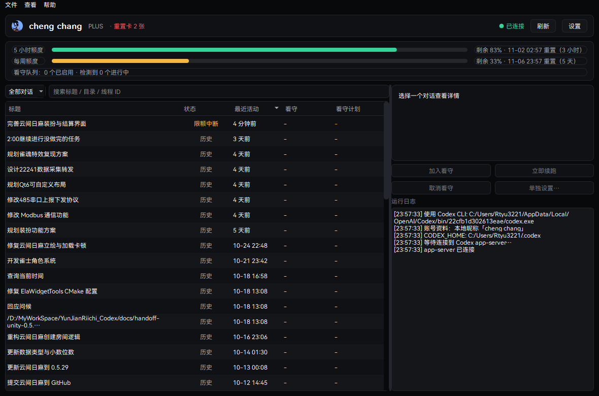
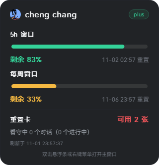
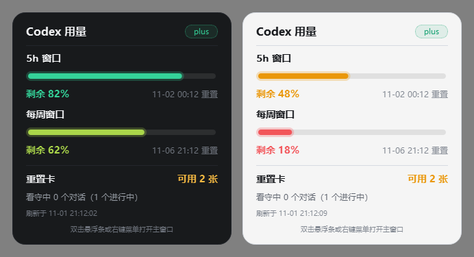
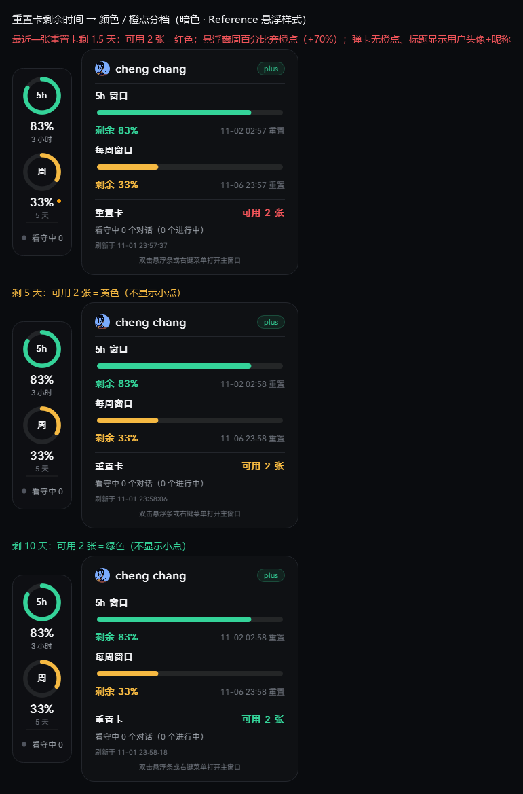
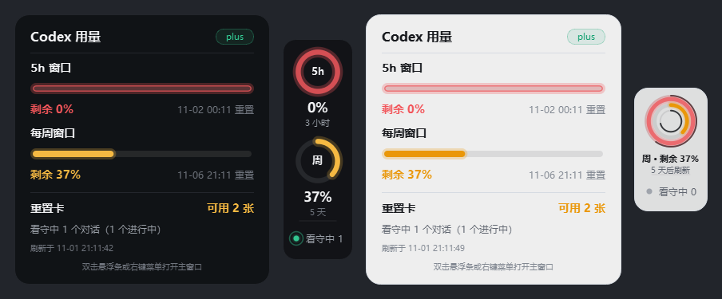
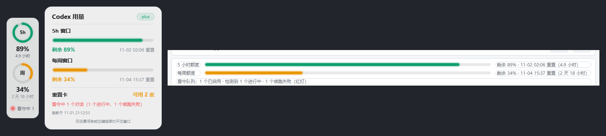

# AutoRun Codex

Windows 桌面小工具：显示 Codex（ChatGPT 账号）的 5 小时 / 每周剩余额度，并在额度重置后自动续跑你选中的对话。














## 下载 / 发布版

- 发布包：[GitHub Releases](https://github.com/Rtyu3221cc/AutoRun_Codex/releases) 中的 `AutoRun_Codex-v0.1.9-win64.zip`（历史版本也在），解压即用、无需安装。
- 运行要求：Windows 10 / 11 x64；本机已安装 **Codex CLI**（程序通过本机 `codex.exe` 的 app-server 读取额度、执行续跑，不代理网络、不内置账号）。若启动提示缺少 VC++ 运行库，先运行包内 `vc_redist.x64.exe`。
- 首次启动会在 `%APPDATA%\AutoRun_Codex\` 生成配置 / 日志；卸载 = 删除程序目录 + 该数据目录。发布包内附 `README.txt` 使用说明。
- 从源码构建见下方“快速开始”；打包发布见 `README.md` 的“发布流程”。

## 交接文档

后续接手/继续开发请先读 [HANDOFF.md](HANDOFF.md)（架构、构建、已知问题、下一步计划）。

## 当前状态

**v0.1.9（M1 + M2 完成，UI + 续跑策略 + 重置卡到期预警 + 账号头像/昵称 + HarmonyOS 字体 + 悬浮条缩放适配 + 写锁冲突自愈）**：已编译通过，已完成端到端集成测试（真实 app-server 拉起 → 读取额度/对话 → 看守任务到点续跑 → 状态持久化）。

- 已发布：代码仓库 [github.com/Rtyu3221cc/AutoRun_Codex](https://github.com/Rtyu3221cc/AutoRun_Codex)，对应发布包 **v0.1.9**（win64 zip，见 Releases）。

- 本轮修复（v0.1.9）·**写锁冲突自愈**：Codex 桌面版打开着某个对话时会独占它的 thread 写锁，本程序用独立 app-server 去 `thread/resume` 会得到 `already has an active writer`，之前的版本会按普通失败重试 3 次然后亮红灯。现在：识别到写锁冲突后进入“等待写锁释放”，**不计失败次数、不亮红灯**，锁一释放立刻自动续跑；设置里新增“写锁被 Codex 桌面版占用时自动关闭桌面版”（默认开）：检测到冲突且**你已离开电脑（系统闲置 ≥5 分钟）**、目标对话也已空闲时，自动关闭 Codex 桌面版释放写锁，之后可再打开桌面版；你正在用电脑时不会未经允许关掉它。另外修正了主窗口“立即续跑”不重置本轮重试计数、一次失败就直接红灯的问题；看守调度日志（开始续跑/失败/重试/等待写锁）现在也会写入 `auto-run-codex.log`，便于事后排查。
- 上一轮修复（v0.1.8）：悬浮条底部“● 看守中 N”徽标此前不跟随“悬浮条缩放”设置——文字固定 12px、绿色/红色呼吸圆点、光晕、涟漪和间距全是写死像素，看守行行高还有 30px 下限，50% 时文字显得很大、会顶到/溢出悬浮条右边界。现在徽标内的文字、圆点、呼吸光晕、涟漪以及看守行行高、分隔线间距全部随缩放比例等比缩放；100% 时与旧版视觉一致，50% 下完整居中、不再截断。对比图见 `docs/widget-scale-50.png`。
- 上一轮新增（v0.1.7）：全软件统一使用随程序打包的 **HarmonyOS Sans SC TW** 字体（8.4MB，已嵌入 exe，exe 约 11.3MB；加载失败自动回退微软雅黑）。
- 上一轮新增（v0.1.6）：弹卡与主窗口标题改为显示**当前 Codex 用户的头像 + 昵称**（取代原来的“Codex 用量”字样）；读取说明与风险见下。
- 上一轮（v0.1.5）：读取 `rateLimitResetCredits.credits[].expiresAt`，按**最近一张可用重置卡的剩余时间**给“可用 x 张”/“重置卡 N 张”取色（<2 天红、<7 天黄、≥7 天绿），并在 <2 天时于悬浮窗外周百分比旁显示橙色小点；悬停可看最近到期时间。三档与浅色主题截图见 `docs/card-credit-expiry.png` / `docs/card-credit-expiry-light.png`。
- 上一轮 UI：弹卡从悬浮条展开 / 收回时被“吸回”的动画；进度条呼吸光晕（与悬浮环同频）；额度颜色按剩余量四档渐变（绿 / 绿黄 / 橙黄 / 红）；任一窗口剩余 0% 时该条/该环整条显示红色呼吸灯（呼吸强度较最初版本收敛），横向光晕两端不再被裁断；浅色黄色改为偏橙的 #EA9709；深浅主题切换时所有文字/状态色即时刷新。
- 本轮续跑策略：额度重置后先等待 150 秒（可设 120~600）再发续跑；失败自动重试，每轮最多 3 次尝试（间隔 2 分钟）；3 次都失败则停止自动重试并把悬浮窗“看守中”呼吸灯由绿变红，等待手动处理。
- 已验证：额度读取（5h/周窗口、重置时间、plan、重置卡数量）、对话列表、待续跑检测、悬浮条、看守队列到点执行、续跑错误落盘。
- 待你实机验收：悬浮窗吸附/拖拽手感、托盘/开机自启（自启开关已进设置但尚未写注册表）、桌面 app 同时打开同一对话时的写锁行为。

## 功能

- **余量显示**：通过本机 Codex CLI 的 `app-server` 读取官方额度接口，显示 5h / 每周窗口已用百分比、重置时间、plan、重置卡数量。
- **统一字体**：所有界面（主窗口、弹卡、悬浮条、设置/线程对话框、日志）统一使用 `resources/HarmonyOS_SansSC_TW.ttf`（HarmonyOS Sans SC TW），随 exe 打包（qrc），不依赖系统安装；加载失败回退 `Microsoft YaHei UI`。
- **账号头像/昵称**：弹卡和主窗口标题显示当前登录用户的头像 + 昵称。昵称/邮箱只从本地 `%CODEX_HOME%/auth.json` 的 id_token 读取（不联网）；头像在本地无缓存（或超过 7 天）时，用本地 token 向 ChatGPT 资料接口发一次**只读** GET 取回头像 URL 并缓存到 `%APPDATA%\AutoRun_Codex\account-avatar.png`。不写账号数据、不刷新 token、不消耗额度/重置卡；设置环境变量 `AR_PROFILE_OFFLINE=1` 可完全禁止联网（退化为本地昵称 + 字母头像）。
- **重置卡到期预警**：解析 `rateLimitResetCredits` 的明细，取最近一张可用重置卡的 `expiresAt`：剩余 <2 天 →“可用 x 张”/“重置卡 N 张”变红，并在**悬浮窗**周用量百分比旁加橙色小点（弹卡里不显示小点）；<7 天 → 黄色（无小点）；≥7 天 → 绿色（无小点）。服务端未返回到期明细时保持黄色。参考样式小点贴百分比文字右侧（间距 5px @100%，按最初 3px 的 +70% 口径），经典样式贴周环右上角，极简样式拼在“周 · 剩余 x%”后。
- **动效与材质**：检测到有对话进行中时，主窗口额度条、额度环与弹卡进度条叠加同频呼吸光晕；弹卡从悬浮条锚点展开、隐藏时收缩回悬浮条；任一窗口剩余 0% 时，该条/该环整条外圈显示红色呼吸灯（即使没有进行中对话也常亮呼吸，左右两端光晕完整）；看守状态为带光晕的平滑呼吸点（0.12→1.0→0.12 往返，2.6s 循环），续跑重试耗尽后变红；悬浮条与弹卡使用半透明背景（无抓屏/模糊，避免卡顿），深浅主题切换即时生效。
- **额度配色**：按“剩余量”四档取色——剩余 ≥75% 绿、50%~75% 绿黄、20%~50% 橙黄、<20% 红；告警仍用红色（仅收敛呼吸强度，不改成橙色），浅色主题黄色改为偏橙的 #EA9709；主窗口、悬浮环、弹卡共用同一个取色函数。
- **极简模式**：单圆双环 + 外/内两条细倒计时弧（5h / 每周刷新倒计时，颜色随主题），中心固定 ChatGPT logo，底部每 3.8 秒交替显示 5h / 每周的百分比与刷新时间；100% 缩放约 92×135。
- **悬浮额度条**：无边框置顶小条，两个圆环（5h / 每周），可拖拽并吸附到屏幕边缘；点击弹出详情卡片（展开/收回动画）；双击打开主窗口；右键菜单。设置里的“悬浮条缩放”（50%~150%）会整体缩放悬浮条与底部“看守中 N”徽标（文字、圆点、呼吸光晕、涟漪一起缩放，v0.1.8）。
- **对话选择**：主窗口列出全部 Codex 对话（历史 / 进行中 / 限额中断），支持搜索、状态过滤、**点击表头排序**（默认最近活动降序）。
- **运行中检测**：结合 rollout 尾部事件与文件写入活动判断“进行中”，大文件尾部截断时也不会误判为历史。
- **看守队列**：
  - 单次：额度重置后自动续跑一次；持续看守：每次该对话被额度限额打断，等下一个窗口继续，直到手动停止。
  - 触发时不会立刻发送：先等待设置里的“重置后续跑等待”（默认 150 秒 ≈ 2.5 分钟），给服务端额度重置留出延迟余量。
  - 失败自动重试：恢复线程 / 发送消息 / 仍被限额都算失败，失败后 2 分钟重试；每轮最多尝试 3 次（可设 1~5）。
  - 3 次都失败：停止自动重试，状态变 Failed，悬浮窗“看守中”绿色呼吸灯变红；需要点“立即续跑”或重新加入看守才会继续。
  - **桌面版写锁冲突不算续跑失败**（v0.1.9）：Codex 桌面版打开着该对话时本程序无法 resume；会进入“等待写锁释放”状态（不消耗重试次数、不亮红灯），锁释放后自动继续；设置里可开启“自动关闭 Codex 桌面版释放写锁”（默认开，仅在你离开电脑 ≥5 分钟且对话空闲时触发）。
  - 每个对话可单独设置 prompt、模式、启用状态。
- **立即续跑**：对任意历史对话立即发送续跑 prompt。
- **安全**：不自动消耗重置卡；不修改 `auth.json` / `config.toml`；续跑通过本机 app-server JSON-RPC 完成；所有动作写日志。

## 快速开始

1. **直接运行**：`dist\AutoRun_Codex.exe`（已用 windeployqt 打包 Qt 依赖）。
2. **Qt Creator**：打开 `CMakeLists.txt`，选 `Desktop Qt 6.6.2 MSVC2019 64bit`，构建运行。
3. **命令行**：`build.cmd` 编译 → `deploy.cmd` 打包到 `dist\`。

首次启动会自动探测 `%LOCALAPPDATA%\OpenAI\Codex\bin\*\codex.exe`；若探测失败，可在“设置”里手动指定路径。

## 发布流程（打给别人用的包）

1. 退出正在运行的实例 → `build.cmd` → `deploy.cmd`（生成 `dist\`）。
2. 运行 `release.cmd`（默认从 `main.cpp` 读取版本号；也可 `release.cmd 0.1.9`）：
   - 生成 `release\AutoRun_Codex-vX.Y.Z-win64\`（dist 内容 + `README.txt` 使用说明）；
   - 压缩为 `release\AutoRun_Codex-vX.Y.Z-win64.zip`，并输出同名 `.sha256`。
3. 上传到 GitHub Release（tag 与版本号一致，如 `v0.1.8`）：
   ```powershell
   powershell -NoProfile -ExecutionPolicy Bypass -File packaging\publish-release.ps1
   ```
   默认从 `main.cpp` 读版本、用 `release\_release-notes-<版本>.md` 作为发布说明（没有则用简短说明）；需要本机已配置 GitHub 凭据（`git push` 可用）。仓库：<https://github.com/Rtyu3221cc/AutoRun_Codex>。
4. 发布前自检：用一个干净的 `%APPDATA%`（或 `AR_SCREENSHOT_DIR` + 隔离 APPDATA）跑一次截图模式，确认能启动、能连 app-server。

## 使用

1. 等待右上角显示“已连接”。
2. 列表中橙色“待续跑”= 因额度限额被打断的对话；蓝色=检测到正在运行。
3. 选中对话：
   - **加入看守**：若对话因限额中断且已知重置时间，则等到“重置时间 + 等待秒数”后自动续跑；否则只登记，等它之后被打断再触发。
   - **立即续跑**：立刻发送续跑 prompt（默认“继续执行未完成的任务”，设置里可改）。
   - **单独设置…**：为该对话设置 prompt、单次/持续看守。
   - **取消看守**：移出队列。
4. 悬浮条：拖到屏幕边缘附近自动吸附；双击打开主窗口；右键菜单可打开主窗口 / 设置 / 退出。
5. 若悬浮窗“看守中”呼吸灯变红，说明某条看守连续 3 次续跑失败：到主窗口看“续跑失败”提示，排查写锁/网络后点“立即续跑”。

## 数据与安全

- 只读取 `$CODEX_HOME/sessions/**/*.jsonl` 的**尾部**与 `thread/list` 元数据；不写入 Codex 数据文件。
- 所有续跑动作通过 `codex app-server` 官方 JSON-RPC（`thread/resume` + `turn/start`）完成，和桌面版共用同一个 Codex 账号与额度。
- **续跑会真实消耗该账号额度**；每轮最多尝试 3 次（间隔 2 分钟），仍失败会转红灯并停止自动重试。
- 默认绝不调用 `account/rateLimitResetCredit/consume`（重置卡只显示不使用）。
- 账号资料：昵称/邮箱只读本地 `auth.json`；头像仅在本地缓存缺失/超过 7 天时，用本地 token 向 ChatGPT 网页端 profile 接口发一次**只读** GET 并缓存到 `%APPDATA%`；不写账号文件、不刷新 token、不消耗额度或重置卡；`AR_PROFILE_OFFLINE=1` 可完全关闭联网（退化为本地昵称 + 字母头像）。
- 你的 Codex 配置是 `sandbox_mode = danger-full-access`，自动续跑等于无人监督全权限执行；请只对可信对话开启持续看守。
- 本程序自己的配置/日志/任务状态在 `%APPDATA%\AutoRun_Codex\`（settings.json / jobs.json / auto-run-codex.log）。

## 已知限制

- 程序启动自己的 `codex app-server` 实例，不是桌面 app 内部实例：续跑后桌面 app 里已打开的对话可能需要重新打开/刷新才能看到最新进度；若桌面 app 持有该对话写锁，可能续跑失败（会记录 lastError，可手动“立即续跑”重试）。
- 桌面 app 的“正在运行”状态无法直接读取，主窗口中的“进行中”来自 rollout 文件活动推断。
- 打开主窗口时若连接断开会自动重连；app-server 子进程长期稳定性仍需观察。
- 重试间隔固定 2 分钟、每轮尝试次数可设；连续失败后需要手动“立即续跑”，不会自动等下一个额度窗口。

## 验证记录

- P0：`codex app-server --stdio` → `initialize` → `account/rateLimits/read` → `thread/list` → 测试线程 `turn/start` / `thread/resume` 均通过；随后删除测试线程。
- 实时额度实测：5h 44%（12:41 重置）、每周 38%、Plus、重置卡 2 张。
- 集成测试：临时线程 + jobs.json 注入“等待 5 秒”看守任务 → 启动 app → 自动 resume + turn/start → turn 完成 → jobs.json 状态变为 Succeeded（4）且 attempts=1 → 清理测试线程。
- UI：1180x780 主窗口、88x277 悬浮条、320x339 弹卡（深/浅主题）离屏渲染截图见上；弹卡展开/收回中间帧与四档颜色见 `docs/card-animation.png`、`docs/card-color-tiers.png`。
- 主题切换回归：弹卡可见时 dark↔light 切换后尺寸不变、文字颜色全部跟随；设置对话框 / 线程设置对话框在浅色主题下标题与提示文字可读。
- 耗尽告警回归：用假数据渲染 5h 剩余 0%，弹卡进度条、悬浮环、极简双环、主窗口进度条均整条红色呼吸，横向进度条两端光晕完整；浅色主题 48% 档显示为偏橙的 #EA9709（见 docs/card-color-tiers.png 右图）。
- 账号资料回归（v0.1.6）：主窗口/弹卡标题显示头像与昵称（本地 id_token 昵称 + ChatGPT 头像）；截图见 `docs/main-window.png` / `docs/quota-card.png`；断网/`AR_PROFILE_OFFLINE=1` 时退化为字母头像。
- 重置卡到期三档回归（v0.1.5）：`AR_SCREENSHOT_FAKE_CREDIT_DAYS=1.5/5/10` 分别渲染红+橙点 / 黄 / 绿，深浅主题均验证；真实数据下最近一张重置卡 11-07 00:34 到期（约 5.4 天）→ 黄色、无小点，与预期一致。截图见 `docs/card-credit-expiry.png`。
- 重试策略集成测试：注入不存在的 threadId，`AR_RETRY_DELAY_SECONDS=2` 缩短间隔；确认自动尝试 3 次后 jobs.json 变 Failed（state=5）、attempts=3、cycleAttempts=3、nextTriggerAt=0，并触发看守红灯（UI 见 docs/watch-failed.png）。

## 路线图

- v0.2：重试间隔/次数可配置、写锁冲突原因归类、完成/失败通知、开机自启注册、多显示器吸附、托盘菜单完善。
- v0.3：goal 模式接入、批量队列、统计与历史图表、重置卡新闻（Pulse 风格预告，可选）。